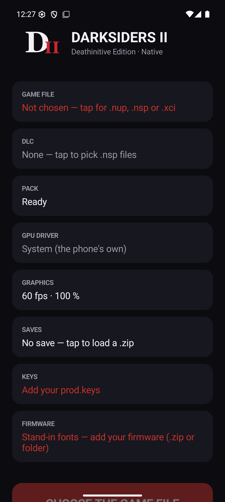

# Darksiders II Native



**Darksiders II Deathinitive Edition** on an Android phone: one app, one button,
60 fps and the resolution you choose.

This is the app: the screen, the game setup, the build flow and the icon are this
repository's. The runtime underneath is [Peanuts Native](https://github.com/igawa6/peanuts-native),
which does the hard part of running the game's code and graphics (see
[Credits](#credits)).

## What this app adds

| | |
|---|---|
| **One screen** | The game file, the DLC, the pack, the GPU driver, the frame rate and resolution, the saves, the console's keys and firmware. No emulator menus. |
| **Builds the `.nup` in the app** | Pick the game's own `.nsp`/`.xci` and any number of DLC packs; `BUILD GAME FILE` merges them into one `.nup` with the importer that ships in the APK. A file that already holds an update is taken as it is, and the app warns if the build is not the one its pack was made for. |
| **60 fps and resolution** | A present-interval switch that holds 60 fps, and a render scale from 50 % to 200 %, both written as the runtime's switches. |
| **Your keys, your firmware** | The APK carries no `prod.keys` and no console font. `KEYS` takes your own `prod.keys`; `FIRMWARE` takes your firmware folder or `.zip` and reads the shared fonts from it. Stand-in fonts (Noto, Droid) keep the game working before that. |
| **Imports the pack** | The `PACK` card takes the code and shader data the runtime needs as a `.zip` (made on a PC, see below) and shows **Ready** once it is in place. |
| **Turnip, picked for you** | Mesa Turnip is selected automatically when it is installed; the GPU driver card installs a driver zip or goes back to the system one. |
| **Saves** | Export and import as a zip. |
| **An icon of its own** | A "D II" monogram drawn for this project (no game art). |

## What you need

The app plays from **two files**: the `.nup` (the game) and the **pack** (the code
and shaders the runtime needs). You can make both **on a PC** (route A) or **on
the phone** (route B).

Common to both routes:

- an Android 13+ phone with **8 GB of RAM or more** (a Snapdragon 8 Gen 2/3 class device);
- **your own copy of the game** (a dump of the card you own), `.xci` or `.nsp`;
- your console's **`prod.keys`**;
- the **DLC** packs, if you want them;
- your **save** as a `.zip`, if you want to bring one.

There is **no update step**: this app and its pack are for the base game (v0). A
file that already carries an update is accepted, and the app warns that the pack
was not made for that build.

| | **A — with a PC** (recommended) | **B — phone only** |
|---|---|---|
| A computer | Windows with WSL2, Linux or macOS | — |
| `prod.keys` on | the PC | the phone |
| Firmware | not needed | optional (console fonts; stand-in fonts otherwise) |
| Who builds the pack | the PC tool | the app |
| Time | ~15–40 min on the PC, then minutes | 1–2 h on the phone |

Nothing is uploaded anywhere: the tools run on your machine and the files stay on
your phone.

## Play it — route A (with a PC, recommended)

1. On the PC, in this repository's [`tools/`](tools/BUILD-PACK.md), run
   `build-pack.cmd` (Windows) or `build-pack.sh` with your game and the DLC. It
   makes **two files**: `DarksidersII.nup` and `pack.zip`.
2. Copy both to the phone (USB, SD card or cloud).
3. Open the app → **PACK** → choose `pack.zip`; the card shows **Ready**.
4. **GAME FILE** → choose `DarksidersII.nup` → **Move into the app** → wait
   (15 GB, a few minutes).
5. **PLAY**.

No keys or firmware on the phone with this route: the `.nup` already holds the
DLC, and the pack holds the shaders.

## Play it — route B (all on the phone)

1. **KEYS** → your `prod.keys`. Without it the app cannot read the game files.
2. **FIRMWARE** *(optional)* → your firmware `.zip` or folder, for the console's
   own fonts. Skipping it is fine.
3. **GAME FILE** → the base `.xci`/`.nsp`. It is only read for now.
4. **DLC** *(optional)* → the add-on `.nsp` files; you can select many at once.
5. **BUILD GAME FILE** → confirm the space, then wait (1–2 h on a phone). You can
   cancel.
6. **PLAY**.

## Your save

**SAVES** → choose a `.zip` to restore a save; the same card exports the current
one as a `.zip`. The save is kept in the app's folder, so it survives updates.

## Build the app from source

The app is an **overlay** on Peanuts Native `v0.1.7-1`. Two pieces:

- `patches/0001-darksiders-hooks.patch` — turns the upstream launcher into this
  app: the single screen becomes the launcher, the build gets the app's name and
  its assets folder, and the firmware picker is made public.
- `overlay/` — the screen (`DarksidersLauncherActivity`), the icons and the
  redistributable fonts.

`apply.sh` clones the release, copies the overlay in and applies the patch.

```sh
./apply.sh                 # clones upstream at v0.1.7-1, copies the overlay, applies the patch
cd peanuts-native/android/app
JAVA_HOME=/path/to/jdk17 ANDROID_HOME=/path/to/android-sdk \
  ./gradlew apk -PnxApp=peanuts -PnxAppId=darksiders -PnxLabel="Darksiders II Native" \
  -PnxGames=010071800BA98000 -PnxPackEngine=fake
# android/app/out/nxnative-android-peanuts.apk
```

Needs `git`, JDK 17 and the Android SDK (build-tools, NDK 28.2). The first build
compiles the native host and takes a few minutes.

A build of your own can carry `assets/darksiders/pack.zip` (the pack, copied on
first start) and then the PACK card is not needed; a public build must not carry
it — the pack holds the game's own translated shaders.

## Tested on

All of the testing so far is on a **Samsung Galaxy S24+ (Snapdragon 8 Gen 3,
Adreno 750)**, Android 16, where it holds a **steady 60 fps** with Mesa Turnip.
(The phone's own Adreno driver works too, but Turnip is what the app selects.)

That is the only device it has been run on. A Snapdragon 8 Gen 2/3 class phone is
what the app is aimed at; on more modest hardware expect a lower frame rate and a
longer first shader build — the **resolution scale** in GRAPHICS (75 % or 50 %) is
the first thing to try. Reports from other phones are welcome.

## Support

This app is free and will stay free. If it is useful to you, you can buy me a
coffee:

- Ko-fi: https://ko-fi.com/hanxlnative
- PayPal: https://www.paypal.com/donate/?business=nmherrerab%40gmail.com&currency_code=USD

## Credits

- [Peanuts Native](https://github.com/igawa6/peanuts-native) by seedds and its
  contributors: the runtime this app is built on (MIT; its Android host is
  GPL-3.0-or-later, see [NOTICE](NOTICE)).
- Mesa Turnip, Noto Sans (SIL OFL) and Droid Sans Fallback (Apache 2.0) for the
  pieces shipped with the app.
- Not affiliated with THQ Nordic, Gunfire Games or Nintendo. The game's names and
  cover art belong to their owners; this app ships neither.

## License

This repository's own files are MIT, see [LICENSE](LICENSE). An APK built with
them also contains Peanuts Native's Android host, so the APK as a whole is
GPL-3.0-or-later; see [NOTICE](NOTICE).
